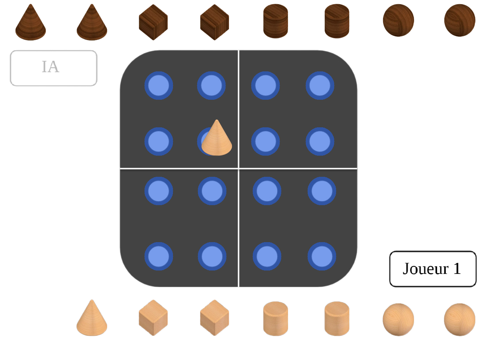

# Quantik en C avec SDL2

Projet de 1re année (ZZ1) à l'ISIMA, réalisé par Julen Somet-Garcia, Valentin Tardy et Henri Finan : le jeu de société **Quantik** en C, avec une interface graphique SDL2 et un adversaire contrôlé par l'ordinateur.



## Règles

Deux joueurs ont chacun 8 pièces : deux cônes, deux cubes, deux cylindres et deux sphères.

- À tour de rôle, on pose une pièce sur une case vide du plateau 4 × 4.
- On ne peut pas poser une forme dans une ligne, une colonne ou un carré où **l'adversaire** a déjà posé cette même forme.
- Gagne celui qui pose la **quatrième forme différente** d'une ligne, d'une colonne ou d'un carré, quelle que soit la couleur des pièces.
- Un joueur qui ne peut plus jouer a perdu.

## Lancer le jeu

Il faut un compilateur C, SDL2 et SDL2_image (`brew install sdl2 sdl2_image` sur macOS, `sudo apt install libsdl2-dev libsdl2-image-dev` sur Ubuntu).

```bash
cd jeu1
make            # compile et lance l'interface graphique
make console    # version dans le terminal
make test       # tests des règles et de l'IA
```

Dans l'interface, choisissez **1 Vs IA** ou **1 Vs 1** : les règles s'affichent, puis un clic lance la partie. Glissez une pièce de votre réserve sur le plateau : les cases autorisées s'affichent en bleu, et une pièce lâchée sur une case interdite revient dans la réserve.

La fenêtre s'adapte à la taille de l'écran et peut être redimensionnée. **F** passe en plein écran, **Échap** en sort ou revient au menu.

## Organisation

| Fichier | Rôle |
|---|---|
| `src/jeu.c` | Règles : coups autorisés, pose et annulation d'une pièce, victoire |
| `src/IA.c` | Adversaire : minimax avec élagage alpha-bêta |
| `src/SDL.c` | Interface : menu, plateau, glisser-déposer, tour de l'IA, écran de fin |
| `src/main.c` | Lance l'interface, ou la version terminal avec `--console` |
| `tests/test_quantik.c` | Tests des règles et parties automatiques |

## L'intelligence artificielle

L'IA explore les coups possibles avec un **minimax** écrit sous forme de negamax : le score est toujours vu du joueur qui a le trait et change de signe à chaque niveau. L'**élagage alpha-bêta** coupe les branches que l'adversaire ne choisirait jamais.

- L'arbre n'est pas stocké en mémoire : chaque coup est joué sur le plateau, exploré récursivement, puis annulé.
- Une victoire vaut 1000 moins le nombre de pièces posées : l'IA gagne le plus vite possible et retarde au maximum une défaite.
- Quand la profondeur maximale est atteinte, la position est évaluée par la différence de coups possibles entre les deux joueurs, puisqu'un joueur bloqué perd.
- En début de partie, il y a jusqu'à 64 coups par tour : l'IA regarde 3 à 6 coups à l'avance. À partir de la 6e pièce posée, elle calcule jusqu'à la fin de la partie.
- Parmi les coups de même valeur, elle en tire un au hasard pour varier les parties.

`make test` fait jouer l'IA contre un joueur qui joue au hasard : elle gagne 200 parties sur 200, en commençant ou en second, et réfléchit moins d'une seconde par coup.

## Historique

Le projet a d'abord été développé en juin 2024 sur les branches `jeu1` à `jeu2`, sans aboutir à une version jouable. La branche `quantik` reprend `jeu1` : les règles ont été corrigées (règle de pose inversée, carrés jamais vérifiés, victoire qui comptait les pièces et non les formes), l'IA a été réécrite pour ne plus stocker l'arbre, et l'interface de Valentin est désormais reliée aux règles et à l'IA.
