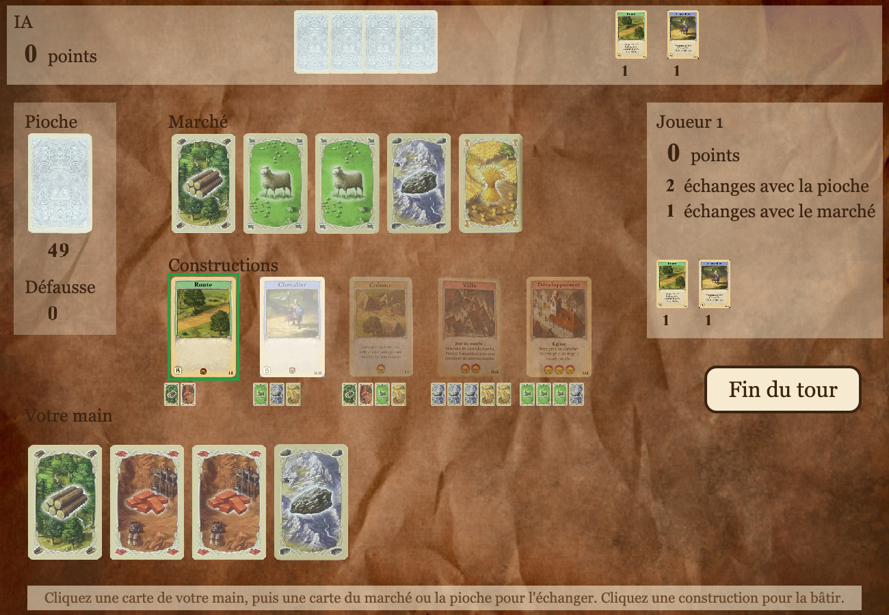

# Projet ZZ1 : deux jeux en C avec SDL2

Projet de 1re année (ZZ1) à l'ISIMA, en juin 2024, par Julen Somet-Garcia, Valentin Tardy et Henri Finan : deux jeux de société en C, avec une interface graphique SDL2 et un adversaire contrôlé par l'ordinateur.

| Dossier | Contenu |
|---|---|
| [`jeu1/`](jeu1) | **Quantik** : plateau 4 × 4, IA minimax alpha-bêta |
| [`jeu2/`](jeu2) | **Catane, le jeu de cartes** : ressources, marché, constructions, IA Monte-Carlo (MCTS) |
| `julen/`, `valentin/`, `henri/` | Les exercices SDL de chacun en début de projet (fenêtres, textures, sprites, parallaxe) |

Il faut un compilateur C, SDL2 et SDL2_image (`brew install sdl2 sdl2_image` sur macOS, `sudo apt install libsdl2-dev libsdl2-image-dev` sur Ubuntu). Dans chaque dossier de jeu :

```bash
make            # compile et lance l'interface graphique
make console    # version dans le terminal
make test       # tests des règles et parties automatiques de l'IA
```

Les deux jeux se jouent aussi dans un navigateur, compilés en WebAssembly avec [Emscripten](https://emscripten.org) : `make web` produit le dossier `build-web/` (page, code et images), à publier tel quel sur un site. La version de bureau ne change pas : les adaptations au navigateur sont dans des blocs `#ifdef __EMSCRIPTEN__` (rendre la main à la page à chaque image, chemin des images). Les jeux en ligne : [Quantik](https://julen.sometgarcia.fr/jeux/quantik/) et [Catane](https://julen.sometgarcia.fr/jeux/catane/).

Dans les deux jeux, la fenêtre s'adapte à l'écran ; **F** passe en plein écran, **Échap** en sort ou revient au menu. Les règles s'affichent avant chaque partie.

## Quantik (`jeu1/`)


Chaque joueur a deux cônes, deux cubes, deux cylindres et deux sphères. À tour de rôle, on pose une pièce sur une case vide, sans jamais poser une forme dans une ligne, une colonne ou un carré où l'adversaire a déjà posé cette même forme. Gagne celui qui pose la quatrième forme différente d'une ligne, d'une colonne ou d'un carré. Un joueur bloqué a perdu.

L'IA est un **minimax avec élagage alpha-bêta** (negamax). Elle ne stocke pas l'arbre : chaque coup est joué, exploré récursivement, puis annulé. Elle regarde 3 à 6 coups à l'avance en début de partie, puis calcule jusqu'à la fin dès la sixième pièce posée. Contre un joueur aléatoire, elle gagne 200 parties sur 200, en moins d'une seconde par coup.

## Catane, le jeu de cartes (`jeu2/`)



Un jeu de cartes à deux inspiré de Catane, avec les cartes ressource (bois, argile, mouton, minerai, blé) et les cartes construction (route, chevalier, colonie, ville, développement). À chaque tour :

1. on complète sa main depuis la pioche : 3 cartes, plus une par chevalier face A ;
2. on peut faire jusqu'à 2 échanges avec la pioche, et un échange avec le marché par route face A ;
3. on peut bâtir une construction en payant son coût.

Route et chevalier ont deux faces : la face A donne un échange ou une carte de plus, la face B un point. La colonie vaut 1 point, la ville 2 (elle remplace une colonie et renouvelle le marché), le développement 3. Le premier à 10 points gagne ; si la pioche est vide, le plus de points l'emporte.

On joue contre l'IA, ou à deux sur le même écran : entre deux tours, un écran cache la main du joueur précédent.

L'IA est un **MCTS** (Monte-Carlo Tree Search) : l'arbre couvre les actions de son tour (échanges, construction, fin du tour), et chaque branche est évaluée en simulant des parties jusqu'au bout. Elle ne triche pas : à chaque simulation, la main de l'adversaire est tirée au hasard parmi les cartes qu'elle ne connaît pas. Elle bat une stratégie gloutonne dans environ trois parties sur quatre.

## Historique

Le projet a été développé sur plusieurs branches qui n'avaient jamais été fusionnées ni terminées. En 2026, elles ont été reprises et réunies dans `main` :

- `jeu1`, `jeu1bis`, `jeu1julen`, `jeu1testIA` → `quantik` : règles réécrites (règle de pose inversée, carrés jamais vérifiés, victoire qui comptait les pièces et non les formes), IA réécrite, interface de Valentin reliée au jeu ;
- `jeu2` et `jeu2fixSDL` → `catane` : état de partie partagé (chaque joueur gardait sa propre copie de la pioche et du marché), règles complétées d'après le code et le texte des cartes, IA MCTS terminée, interface reprise sur les images de Valentin et le découpage en phases de l'automate de `jeu2fixSDL`.
